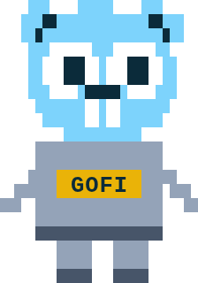
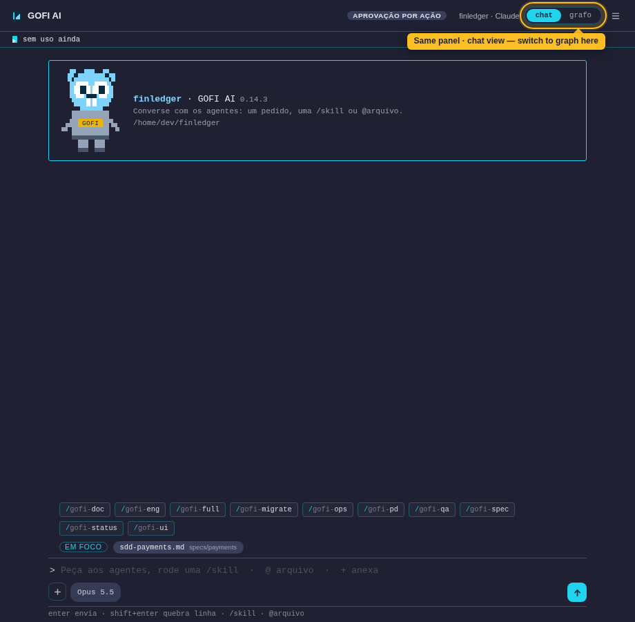
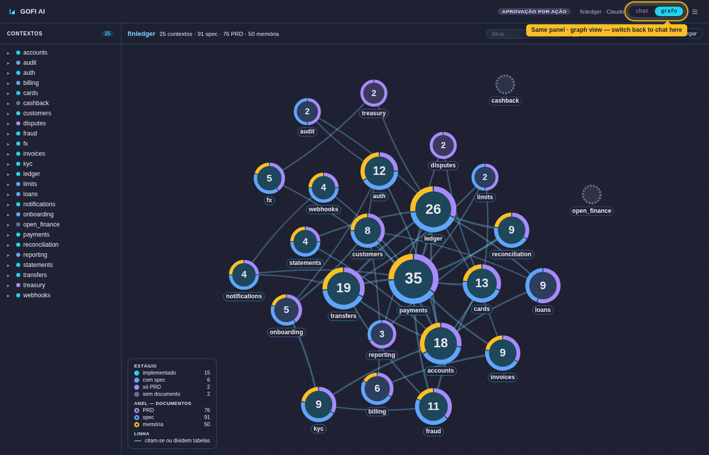

<p align="center">
  
</p>

<h1 align="center">gofi</h1>

<p align="center">
  <b>An agentic delivery loop over code and document graphs.</b><br>
  You write and approve the requirements. gofi implements, tests, audits and corrects them —
  deterministically checked, within a budget, and recorded.
</p>

<p align="center">
  <a href="https://github.com/joaoprofile/gofi/releases"></a>
  <a href="LICENSE"></a>
  
</p>

<p align="center">
  <a href="#quick-start">Quick start</a> ·
  <a href="#how-it-works">How it works</a> ·
  <a href="#the-delivery-loop">Delivery loop</a> ·
  <a href="#the-code-graph">Code graph</a> ·
  <a href="#cli-reference">CLI</a> ·
  <a href="#configuration">Configuration</a> ·
  <a href="#measured-results">Results</a>
</p>

---

## Overview

gofi is a harness for building software with AI coding agents. It splits the work
where it belongs:

- **The person owns the contract.** Requirements and scenarios live in versioned
  specs; a change to them is proposed, reviewed and **approved by a person**.
- **The loop owns the delivery.** An approved change runs through a declared flow
  of agents and deterministic sensors — build, static analysis, tests, the code
  graph's architecture rules, traceability, integrity — until it is accepted, or
  stops with the reason for the person to decide.
- **Facts dispatch the roles, never a prompt.** Which roles implement, test and
  audit a change is computed from the change itself and from the code graph.

It ships as a single binary — the `gofi` CLI, with an MCP server and the
**GOFI AI** VS Code extension embedded — and this repository, the source of the
roles, templates and knowledge that `gofi init` installs into a project.

### Features

| | |
|---|---|
| **Delivery loop** | Flows as graphs with bounded cycles; checkpointed after every node; resumable; cancellable; runs in git worktrees and lands by fast-forward |
| **Deterministic sensors** | `integrity`, `build`, `static`, `test`, `graph`, `trace`, plus optional `security` and `coverage` — read into findings with file and line |
| **Code graph** | Go (syntax or type-checked), TypeScript/JavaScript, Python, Java and Rust extractors; byte-deterministic, versioned, diffed per run |
| **Architecture rules** | `deny: A -> B`, `deny: import`, `deny: new-cycle`, `deny: new-cross-context-edge` — checked on what the change added |
| **Audit in lenses** | Conformance, tests, security, data and UI lenses in parallel, merged by fingerprint; the general lens alone as a cheaper mode |
| **Anti-cheating** | The contract is write-protected for agents; a removed test, an added skip or a removed assertion fails the run |
| **Batches** | `gofi run --all` delivers every approved change in dependency order, in parallel, under one shared budget, resumable |
| **Learning** | A run that needed rework proposes the lesson that would have avoided it; the person accepts or rejects it |
| **Token economy** | Isolated agent turns, briefs scoped to the role, green stages cached by tree, tier per role |
| **Hosts** | Claude Code, Codex and Copilot, each role limited to the tools its contract grants |
| **Languages** | Go, TypeScript (NestJS), Python (FastAPI), Java (Quarkus) and Rust (Axum) |

---

## Quick start

**Requires** [Claude Code](https://docs.claude.com/en/docs/claude-code) 2.1.277 or newer
for the agents. The index, search and MCP commands work with any agent.

```sh
# Install (Linux / macOS)
curl -fsSL https://raw.githubusercontent.com/joaoprofile/gofi/main/install.sh | sh
# Install (Windows, PowerShell)
iwr -useb https://raw.githubusercontent.com/joaoprofile/gofi/main/install.ps1 | iex

# See what an existing repository already holds — writes nothing, no model
gofi scan

# Create a project, or adopt an existing repository
gofi init my-service

# Write the contract with the agents, then approve it
gofi chat                                   # or the GOFI AI panel in VS Code
gofi review add-rate-limit                  # the reviewer reads the change first
gofi change approve add-rate-limit          # your approval seals it

# Let the loop deliver it
gofi run add-rate-limit --detach
gofi watch                                  # follow it live
gofi report <run>                           # what was delivered, traced and audited
```

<details>
<summary>More install options</summary>

```sh
# A specific version
GOFI_VERSION=v0.4.0 curl -fsSL https://raw.githubusercontent.com/joaoprofile/gofi/main/install.sh | sh
# A custom directory
curl -fsSL https://raw.githubusercontent.com/joaoprofile/gofi/main/install.sh | sh -s -- --bin-dir /opt/gofi/bin
```

The installer verifies the SHA-256 against `checksums.txt`. Defaults:
`/usr/local/bin` (or `~/.local/bin`) on Linux and macOS,
`%LOCALAPPDATA%\Programs\gofi\bin` on Windows. `gofi settings` configures the CLI
(language `en`/`pt`, output); `gofi config` configures the project.

</details>

---

## How it works

```
  PRD ──▶ change ──▶ review ──▶ approval ──────────────────▶ gofi run
 /gofi-pd /gofi-spec gofi review  gofi change approve               │
                                   (the person)                     ▼
 ┌────────────────────────────── delivery flow ──────────────────────────────┐
 │                                                                           │
 │  plan ─▶ implement ─▶ test ─▶ sense ─────────────▶ audit ─▶ policy        │
 │           (by layer)          │  integrity build    (lenses)   │          │
 │              ▲                │  static test graph             ├─▶ accepted ─▶ deliver ─▶ learn
 │              │                │  trace [security coverage]     │          │      (commit,       (lesson
 │              └── repair ◀─────┘ failed                         │          │       archive)       proposed)
 │              └──────────────── findings open ◀─────────────────┤          │
 │                                                                ├─▶ triage ─▶ impasse (amendment for the person)
 │  gate: a decision the change does not cover ──▶ gofi answer    └─▶ exhausted (budget or iterations)
 └───────────────────────────────────────────────────────────────────────────┘
```

1. **The contract.** `specs/<context>/spec.md` is the living truth of a context —
   requirements (`REQ-NN`) and scenarios (`REQ-NN.n`), no technology. Work is a
   **change** in `specs/changes/<id>/`: a proposal, a delta per context and a design.
2. **Review and approval.** `gofi review` runs `gofi spec check` (no model) and a
   reviewer that looks for ambiguity, contradiction, untestable scenarios and gaps.
   Approval seals each document with its hash; editing it afterwards breaks the seal.
3. **Delivery.** `gofi run` walks the flow. Every agent turn starts fresh and reads
   the state from disk; every transition is written to `events.ndjson` with why it
   was taken.
4. **Archive.** Accepted, the change becomes one commit and its deltas are applied
   to the living specs, by id, with no model.

---

## The delivery loop

### Flows

A flow is a declared graph — `sensor`, `agent`, `policy`, `gate` and `terminal`
nodes — with every cycle bounded. The built-in flows are `delivery` and `audit`
(audit an existing implementation, fixing nothing); a project can declare its own.

```sh
gofi flow check                 # validate every flow, no model
gofi run <change> --explain     # what each agent node would dispatch, and why
```

### Roles, dispatched by facts

Roles are skills with a `contract.yaml` — stage, layer, triggers and tools. A node
of a stage dispatches the roles whose triggers hold, from a closed vocabulary of
facts gofi computes: `change.surface(web)`, `layer(data)`, `sensor.failed(graph)`,
`verdict(rejected)`, `owner(spec)`, `diff.touches(api)`, `run.reworked`, `stuck`…

| Stage | Roles |
|---|---|
| contract | `gofi-spec-review` |
| plan | `gofi-plan` — tasks per layer: `data`, `domain`, `integration`, `api` |
| implement | `gofi-eng-data`, `gofi-eng`, `gofi-integrate`, `gofi-eng-api`, `gofi-ui` (web, mobile), `gofi-ops` (infra) |
| test | `gofi-test` — from the scenarios, never by the author of the code |
| repair | `gofi-repair` — only what a sensor reported; starts on the light tier |
| audit | `gofi-qa` (general lens), `gofi-qa-conformance`, `gofi-qa-tests`, `gofi-qa-security`, `gofi-qa-data`, `gofi-qa-ui` |
| triage | `gofi-triage` — root cause and an amendment proposal when the loop cannot go on |
| deliver | `gofi-deliver` (commit message), `gofi-doc` (API contract docs, when the change touched `api`) |
| learn | `gofi-learn` — the lesson a reworked run teaches |

```sh
gofi role list                              # visibility, stage, tier and triggers
gofi role run gofi-qa "audit pedidos"       # one turn of a role, to debug it
```

### Sensors

The `sense` node runs the stages in order and stops at the first that fails. A stage
with no command is recorded as **not checked** — never as passed. A green `build`,
`static` or `test` is not run again on the same git tree.

| Stage | Checks |
|---|---|
| `integrity` | The run did not win by cheating: contract unchanged, no test removed, no skip added, no assertion removed |
| `build` | The code compiles |
| `static` | The language's linter finds nothing |
| `test` | The tests pass; a skipped test fails the stage |
| `graph` | The code graph rebuilt, diffed against the run's baseline, and held to the architecture rules |
| `trace` | Every requirement has code that implements it and every scenario a test |
| `security`, `coverage` | Optional: any tool named in `loop.sensors`, reading SARIF, JUnit or `file:line` output |

Each language **pack** brings its commands, its test and source patterns, its layers
and its default architecture rules:

| Language | build | static | test |
|---|---|---|---|
| Go | `go build` | `go vet` | `go test -json` |
| TypeScript (NestJS) | `tsc --noEmit` | ESLint (SARIF) | Jest (JUnit) |
| Python (FastAPI) | mypy | Ruff (SARIF) | pytest (JUnit) |
| Java (Quarkus) | `mvn compile` | PMD (SARIF) | Surefire (JUnit) |
| Rust (Axum) | `cargo build` | Clippy | `cargo test` |

### Policy

The policy decides from the sensors and the verdict, never from what a model says:
accept, go back to work, raise a role one tier, triage, or stop. It is bounded by
`loop.max_iterations` and `loop.budget_usd`; `loop.accept` chooses between a clean
verdict and one with caveats; `loop.escalate` says when a role that does not
progress runs one tier up.

### Audit

By default the audit runs in **lenses** at the same time, each reading only what the
change touched according to the graph. Verdicts are merged by fingerprint: the
highest severity wins, and a disagreement on the owner goes to triage. `loop.audit:
single` runs the general lens alone — cheaper, with lower recall (see
[Measured results](#measured-results)).

### Gate

A role that meets a decision the change does not cover writes the question and
stops. The run waits at its gate; anyone answers it, from any terminal or from the
chat:

```sh
gofi answer <run>                       # asks each question
gofi answer <run> --set q1=paginated    # answers one; the rest take the recommendation
```

### Worktrees, landing and resume

```sh
gofi run <change>                 # in the project's tree, checkpointed in git
gofi run <change> --worktree      # in a worktree of its own (always with --detach)
gofi run <change> --detach        # in the background; prints the run id
gofi cancel <run>                 # stop at the next checkpoint
gofi run --resume <run>           # go on where it stopped
```

Worktrees live in the user cache, never inside the project. An accepted branch is
rebased once every change it depends on has landed and fast-forwarded into the
current branch — never merged, never pushed. A conflict keeps the branch for the
person.

### Batches

```sh
gofi run --all --parallel 2               # every approved change, by depende_de
gofi run --all --resume b-20261104-101500 # go on with a batch
```

Changes run level by level; a change whose dependency was not accepted is skipped,
the others go on. The runs share `loop.run_budget_usd` as they spend: once it is
spent, the runs under way stop at their next checkpoint and the rest does not
start. The batch's state and summary go to `.gofi/batches/`.

### Observe

```sh
gofi ps                 # the runs and where each one is
gofi watch              # the runs and their agents, live
gofi logs -f <run>      # each node, the edge taken and why
gofi report <run>       # trace, what changed, the audit and the cost
gofi trace <change>     # requirements → code → tests, with the gaps
```

### Learning

```sh
gofi learn                        # the lessons runs proposed
gofi learn accept <run> <n>       # into the project's knowledge
gofi learn reject <run> <n>
```

### Token economy

- **Isolated turns.** A loop turn loads the project's settings only, gofi's MCP server
  only, and the sections of `AGENTS.md` it works by: 42.6k → 33.9k tokens of fixed
  prefix per turn.
- **Scoped briefs.** Failures and open findings go only to the roles that fix them,
  each finding once and short; an audit is told the symbols the change touched.
- **Tiers, not models.** `light`, `standard` and `deep` map to the host's models;
  `ai.tiers` pins them.
- **No repeated work.** A green stage is not run again on the same tree; a review is
  kept with the hash of what it read.

---

## The code graph

`gofi index code` extracts the structure of the code into a graph that agents query
instead of scanning files. No embeddings, no vector store: the graph comes from each
language's syntax tree and is **byte-deterministic**, so it is versioned in
`.gofi/index/code/` and diffs cleanly.

| Language | Extractor |
|---|---|
| Go | `go/ast` (fast) or `go/types` (`--deep`, exact, needs the code to compile) |
| TypeScript / JavaScript | built in |
| Python | bundled (`ast`) |
| Java | bundled (`com.sun.source`, built on first use) |
| Rust | bundled (`syn`, built with cargo on first use) |

The fast mode never guesses: an ambiguous call is counted as ambiguous, not turned
into an edge that might be wrong.

```sh
gofi find "<question>"              # documents and code, ranked
gofi show Server.Start              # signature, doc, file:lines, callers, callees
gofi path handler.Login store.User  # how A reaches B, edge by edge
gofi impact service.Bill            # what a change to it can break, by context
gofi index status                   # does the index still match the project?
gofi index open                     # the graph in the browser
```

### Architecture rules

Rules are declared per language pack and per project (`graph.rules`) and checked by
the `graph` stage **on what the change added** — an old violation does not fail a
new change:

```yaml
graph:
  rules:
    - "deny: handler -> repository"                # a layer never reaches another
    - "deny: import \"database/sql\" from handler" # an import a layer must not use
    - "deny: new-cycle"                            # no new call cycle
    - "deny: new-cross-context-edge"               # contexts meet only where the change declares
```

### Traceability

Code and tests point at the contract's stable ids, and the `trace` stage holds the
change to them:

```go
// gofi:implements REQ-04
func (s *Service) Bill(...) { ... }

// gofi:tests REQ-04.1
func TestBillRefusesAnEmptyOrder(t *testing.T) { ... }
```

```sh
gofi show req:pedidos/REQ-04       # a requirement, its code and its tests
```

---

## The document graph

`gofi index docs` indexes PRDs, specs, context memory and the reference libraries
section by section, with line ranges. An answer is `file#section L12-26`, never
"read this file". Documents link to the tables they describe and, through them, to
the code that implements them.

```sh
gofi show ctx:pricing                    # documents, tables, packages, neighbours
gofi show specs/pricing/spec.md#REQ-04   # one requirement with its scenarios
gofi show table:order_order              # who describes the table, who implements it
gofi index check                         # validate the corpus and measure search (CI)
```

---

## Interfaces

### Terminal chat and requests

```sh
gofi chat                          # plan, conduct and follow a request in the terminal
gofi ask "<request>"               # one call, script-friendly
gofi intake "<request>" --json     # the plan alone: context, phases, tiers, questions
```

The chat plans free text by rules first, stops after a PRD or a spec for review —
with the reviewer's findings — and hands the build to the loop. `Esc` stops a
delivery at its next checkpoint; a gate's questions are asked in the chat.

### GOFI AI for VS Code

Embedded in the binary; `gofi init` installs it, `gofi install extensions` updates it.

- The same conducted flow as `gofi chat`: review before approval, delivery by the
  loop, gate questions as cards, stop, cost per run.
- A run tab: the flow as a graph with the path taken, the sensors (not checked is
  shown apart from passed), the verdict, open findings, the amendment, the branch,
  the trace matrix — followed live. Batches appear in the same picker.
- A map of the project's contexts, per-action approval of edits and commands, and
  a token meter with a retrieval audit.

<table>
  <tr>
    <td width="40%"></td>
    <td width="60%"></td>
  </tr>
</table>

### MCP server

`gofi mcp` serves the index and the loop's checks to any MCP client over stdio.

| Tool | Does |
|---|---|
| `find`, `show`, `path`, `impact` | Query the code and document graphs |
| `intake` | Plan a request (rules only) |
| `index_status`, `index` | Check or rebuild the index |
| `verify` | Run the loop's sensors — build, static, test, and with a run the graph and trace |
| `verdict_write`, `memory_write` | Record an audit's verdict, write a context's memory — checked first |

### Hosts

| `ai.host` | Agents | Per-role tool grants |
|---|---|---|
| `claude-code` | Claude Code | allowed and disallowed tools; contract files write-protected |
| `codex` | Codex CLI | read-only sandbox for roles that change nothing; gofi's MCP tools per role |
| `copilot` | Copilot CLI | `--deny-tool` for what the role is not granted |

---

## CLI reference

**Project**

| Command | |
|---|---|
| `gofi scan [path]` · `--json` | Read any repository: code and contexts, documents that read as PRD, spec, decision or API contract, Gherkin scenarios, API contracts, tables — and what is next. Writes nothing |
| `gofi init` | Create a project or adopt a repository |
| `gofi config` · `gofi settings` | The project's `.gofi.yaml` · the CLI's own settings |
| `gofi update [skills\|agents\|expertise\|templates\|sdk\|ds\|institutional\|audit]` | Pull what is gofi's from upstream; `audit` changes nothing |
| `gofi install [extensions\|mcp\|guard\|hooks]` | Wire gofi into the editor and the agent |
| `gofi doctor` · `gofi version` | Check the environment · build info |

**Contract**

| Command | |
|---|---|
| `gofi change new <id> --context <ctx>` | Create a change from the templates |
| `gofi change list` · `approve <id>` · `archive <id>` | List · seal · apply to the living specs |
| `gofi review <change>` · `--context <ctx>` · `--again` | Review before approval |
| `gofi spec check` · `approve` · `order` · `migrate` | Validate · seal a living spec · build order · migrate format 2 |

**Delivery**

| Command | |
|---|---|
| `gofi run <change>` · `--context <ctx>` · `--all` | Deliver one change, a context's, or all of them |
| `--detach` · `--worktree` · `--parallel <n>` · `--resume <run\|batch>` · `--explain` · `--no-archive` | |
| `gofi answer <run>` · `gofi cancel <run>` | Answer a gate · stop a run |
| `gofi ps` · `gofi watch` · `gofi logs [-f] <run>` · `gofi report <run>` | Observe |
| `gofi learn [accept\|reject <run> <n>]` | Lessons proposed by the runs |
| `gofi flow check [<flow>]` · `gofi role list` · `gofi role run` | Flows and roles |
| `gofi verdict write <context>` · `gofi memory write <context>` | Write a verdict or a memory, checked |

**Graph and search**

| Command | |
|---|---|
| `gofi index [code\|docs]` · `--deep` · `--full` | Build the code graph and the document index |
| `gofi index status` · `check` · `open` · `install <lang>` · `hooks` · `migrate` | Maintain it |
| `gofi find` · `gofi show` · `gofi path` · `gofi impact` · `gofi trace` | Query it |
| `gofi mcp` · `gofi guard [warn\|enforce\|off]` | Serve it · keep agents asking it before scanning |

**Requests**

| Command | |
|---|---|
| `gofi chat` · `gofi ask` · `gofi intake` | Talk to the agents · one request · plan only |

**Quality and measurement**

| Command | |
|---|---|
| `gofi bench` · `--parallel <n>` · `--keep` | Deliver gofi's suite of changes on a copy of the project |
| `gofi bench audit` · `--judge <id>` | Audit recall on planted defects, lenses vs general lens; rescore a run for free |
| `gofi test` · `gofi hsec` · `gofi sonar` | Test tasks · Horusec SAST · SonarQube |

`gofi h <command>` shows the full help of any command.

---

## Configuration

`.gofi.yaml` at the project root; `gofi config` edits it.

```yaml
project:
    name: payments
backend:
    language: go                 # go | nodejs | python | java | rust
    path: backend
ai:
    host: claude-code            # claude-code | codex | copilot
    model: claude-sonnet-5-5     # the conversation's model
    guard: warn                  # warn | enforce | off
    tiers:                       # optional: pin each tier
        light: claude-haiku-5-5
        standard: claude-sonnet-5-5
        deep: claude-opus-5-5
loop:
    max_iterations: 6            # ways back to work before the run is exhausted
    budget_usd: 5                # what one run may spend
    run_budget_usd: 20           # what a batch may spend, all its runs together
    max_agents: 2                # changes at once in a batch
    accept: clean                # clean | ressalvas
    escalate: on_no_progress     # on_no_progress | on_first_reject | never
    audit: lenses                # lenses | single
    gate_timeout: 30m
    sensors:                     # override or add stages
        security: {run: "horusec start -p {src} -o sarif -O out.sarif", format: sarif, report: out.sarif}
        coverage: "make coverage-gate"
graph:
    deep: false
    rules:
        - "deny: new-cross-context-edge"
```

In VS Code: `gofiAI.gofiPath` (the binary), `gofiAI.model` (the panel's model),
`gofiAI.intake` (plan free text and conduct the phases).

---

## Measured results

Measured with `gofi bench`, `gofi bench audit` and the goldens of this repository.

| What | Result |
|---|---|
| Audit recall on planted defects, 5 rounds × 3 cases × 5 defects | lenses **100%** · general lens alone **97.3%** |
| Audit cost per case | lenses **$2.69** (5 turns) · general lens **$0.97** (1 turn) |
| Delivery suite (4 changes: easy, contract gap, trap, two layers) | **4/4 accepted**, 3 on the first pass, $15.74 |
| Fixed prefix of a loop turn (Claude Code) | 42.6k → **33.9k tokens** |
| Search: right document in the top 3 | **97%** (held-out: 92%) |
| Planning a request, rules only | **0.4–0.9 s, 0 tokens**; ~10 ms with the index kept loaded |
| Code graph, Go fast mode | 1.4 s for 336 packages / 700k lines |

---

## Repository layout

```
ai/          what gofi installs into a project: AGENTS.md, skills and roles, expertise,
             templates, SDK docs, institutional seed
cli/         the Go CLI: loop, sensors, graph, packs, engines, MCP server, chat
vscode/      the GOFI AI extension, embedded into the CLI
```

## Build from source

```sh
cd cli
go build -o bin/gofi ./cmd/gofi
GOWORK=off go test ./...
cd ../vscode && npm test
```

After changing `vscode/`, regenerate the embedded extension with
`go generate ./internal/extensions`. Releases are built by GoReleaser on a `v*` tag.

The agents build on the gofi SDKs — [gofi-sdk-go](https://github.com/joaoprofile/gofi-sdk-go)
and [gofi-sdk-rust](https://github.com/joaoprofile/gofi-sdk-rust) — which fix the
layers, libraries and practices so the same spec yields the same shape of code.

## Author

Created by **João Carvalho** — [GitHub](https://github.com/joaoprofile) ·
[LinkedIn](https://www.linkedin.com/in/joaoprofile).

## License

[MIT](LICENSE)
